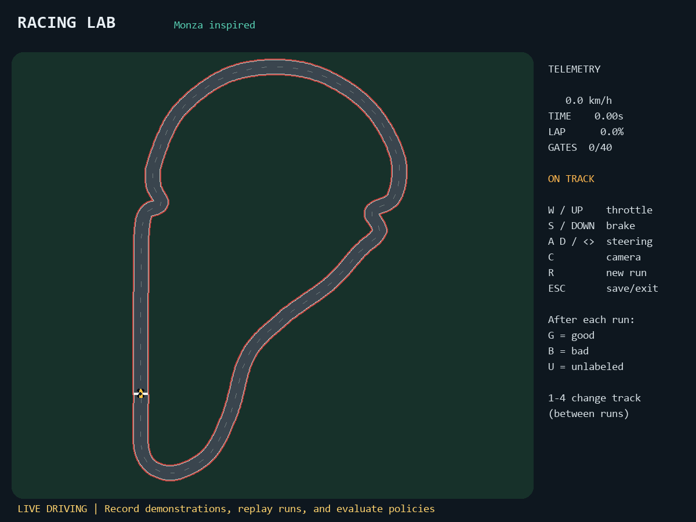

# Racing Lab

A local Python 2D racing game and a shared simulation environment for human demonstrations, supervised imitation, inverse optimization (IO), inverse reinforcement learning (IRL), and reinforcement learning (RL) experiments.

Drive with a keyboard, save imperfect but useful demonstrations, replay them, train a behavior-cloning baseline, and evaluate policies on four circuit-inspired tracks. No image observations, web service, or GPU is required.



**Status:** initial research prototype. Behavior cloning is implemented. IO/IRL solvers and RL training algorithms are extension points, not included implementations. There is no claim that imitation will outperform its demonstrator.

## Install and play

Python 3.10 or newer is required (tested locally on Windows/Python 3.13).

```powershell
git clone https://github.com/aqaPayam/racing-lab.git
cd racing-lab
python -m venv .venv
.\.venv\Scripts\python -m pip install -e ".[dev]"
.\.venv\Scripts\python -m racing_lab.cli play --track monza
```

After installation on Windows, double-click **play.bat**. On Linux/macOS, activate your virtual environment and use `python -m racing_lab.cli` or the installed `racing-lab` command. The remaining examples assume an activated virtual environment:

```powershell
.\.venv\Scripts\Activate.ps1
```

| Key | Action |
| --- | --- |
| W / up | Throttle |
| S / down | Brake |
| A, D / left, right | Steer |
| C | Switch overview / following camera |
| R | End current run and choose a label |
| G / B / U | Save as good / bad / unlabeled, then start a new run |
| 1 / 2 / 3 / 4 | Between runs, choose Monza / Silverstone / Spa / Suzuka |
| Esc / close window | Save current run as unlabeled and exit |

Laps finish automatically after all 40 checkpoints and the finish line. The labeling screen also appears after a 300-second timeout. You may label interrupted runs, but the metadata keeps their completion status. Recording starts immediately; hold throttle to move. Brake before sharp turns. Full throttle through every corner will exceed grip.

## Tracks

`monza`, `silverstone`, `spa`, and `suzuka` are selectable with `--track`. These are original, hand-authored **approximations inspired by circuit shapes**, not surveyed replicas or official assets. Distances and widths are scaled for this prototype. There is no elevation or banking; Suzuka is explicitly adapted to avoid a bridge crossing. No F1 branding assets are included, and this project is not affiliated with Formula 1 or the circuits.

Add a JSON file under `racing_lab/tracks/` with `name`, `version`, `width` (metres), and an ordered loop of `[x, y]` centerline control points. Coordinates use screen-style positive y downward. The road is interpolated with a periodic Catmull-Rom curve. Avoid intersecting roads and bends closer together than their widths. Increment the version whenever geometry changes; recordings also store a SHA-256 digest of the exact file.

## Collect → train → evaluate

1. Drive at least five varied runs and label your useful demonstrations **good**. All recordings go to `data/`; nothing is automatically uploaded.
2. Inspect or replay a recording:

```sh
python -m racing_lab.cli inspect data/RECORDING.npz
python -m racing_lab.cli replay data/RECORDING.npz
```

3. Train the numerical-observation behavior-cloning baseline:

```sh
python -m racing_lab.cli train --data data --output models/bc.npz --epochs 100
```

Only `good` runs with `source=human` are selected. At least two are required. Entire runs are split into training and validation sets, so neighboring frames cannot leak across the split. The MLP has two 64-unit ReLU layers; normalization is fitted on training data only. Model weights are portable NumPy arrays, not pickle files. A JSON report lists the split and held-out action MSE. A tiny dataset can produce a poor driver even with low MSE.

4. Watch the learned policy, then evaluate it headlessly:

```sh
python -m racing_lab.cli evaluate --model models/bc.npz --track monza --episodes 1 --render
python -m racing_lab.cli evaluate --model models/bc.npz --track all --episodes 5 --output results/bc.json
```

Evaluation reports completion, lap time (null on failure), progress, off-track fraction, action smoothness, reward, seed, and track hash. Start offsets are randomized with `--jitter` (default 1 metre); seed sequences are fixed. Compare algorithms with identical tracks, timeouts, seeds, jitter, and reward weights. Report success rate separately from lap time on successful runs.

For a controller smoke test, omit `--model`:

```sh
python -m racing_lab.cli evaluate --track all --episodes 1
```

This conservative geometric reference driver has privileged access to the track and is **not** a learned policy or a human demonstration source.

## Python / Gymnasium interface

```python
import gymnasium as gym
import racing_lab  # registers RacingLab-v0

env = gym.make("RacingLab-v0", track="monza", max_seconds=300)
obs, info = env.reset(seed=42)
while True:
    action = [0.0, 0.5, 0.0]  # steering [-1,1], throttle [0,1], brake [0,1]
    obs, reward, terminated, truncated, info = env.step(action)
    if terminated or truncated:
        break
env.close()
```

Replace the example action with your policy. Human play and headless training call exactly the same `step()` function at a fixed 1/60-second simulation interval. Rendering is optional. Human play advances one simulation step per frame and slows under rendering overload instead of silently dropping control samples.

The 20 float32 observations contain normalized speed, lateral speed, yaw rate, steering angle, lateral road offset, sine/cosine of road-relative heading, road half-width, and six upcoming centerline positions expressed in car coordinates (10, 25, 50, 90, 150, 230 metres ahead). This is a compact local-road description, not global coordinates or images. The preview coordinates and known width describe the nearby road; they do not encode every possible custom-track topology. See `OBS_NAMES` in `racing_lab/env.py` for ordering and normalization.

The simulator uses a simplified bicycle model, steering slew limits, speed-dependent cornering grip, lateral slip, drag, and off-road deceleration. It is an approachable game model, **not an engineering-accurate F1 model**. Cars cannot reverse. Ordered road checkpoints discourage shortcuts; they do not constitute exact continuous boundary enforcement between gates.

## Dataset format and inverse-learning hooks

Each `.npz` file loads with `numpy.load(path, allow_pickle=False)`:

| Array | Shape | Meaning |
| --- | --- | --- |
| observations | T+1 × 20 | Initial observation and every next observation |
| states | T+1 × 7 | x, y, heading, speed, lateral speed, yaw rate, steering |
| actions | T × 3 | Controls applied from observation t to observation t+1 |
| rewards | T | Scalar reward |
| reward_features | T × 4 | Progress delta, negative dt, negative off-road dt, negative squared action change |
| terminated / truncated | T | Gymnasium terminal and timeout flags |
| timestamps | T+1 | Simulation seconds |
| metadata | scalar JSON | Label, source, track version/hash, seed, schema, names, weights, outcome, stop reason |

Manual exits/interruption are described by `reason` and do not falsely set a simulator timeout flag. Full states support exact visual trajectory replay; replay does not depend on a newly trained model. Replay requires the matching installed track hash.

Reward is a weighted sum of the four recorded features. Defaults are `progress=1`, `time=0.1`, `offtrack=2`, `smoothness=0.02`. Override through `RacingEnv(reward_weights={...})`. This keeps feature-level evidence available for inverse methods; labels make no assumption that a human run is optimal. The physical `states` array does not include all episode bookkeeping; use action replay from the same seed for simulation reconstruction rather than treating a state row as a complete environment checkpoint.

For track-generalization experiments, collect training data only on selected circuits and evaluate separately on held-out circuits. The ordinary training split is by run, not automatically by track. Keep the test set out of parameter tuning.

## Development

```sh
python -m pytest -q
```

Tests cover the Gymnasium contract, determinism, invalid actions, timeouts, checkpoint requirements, full reference-controller laps on all four circuits, dataset alignment, training/export/inference, and headless rendering. GitHub Actions is configured for Windows and Linux with Python 3.11 and 3.13.

Contributions are welcome: improve geometry, add controllers, propose explicit IO/IRL formulations, or extend evaluation. Keep simulation separate from rendering; preserve dataset compatibility or bump its schema. Run tests and document algorithm assumptions. Demonstrations, models, environments, and local results are git-ignored by default.

Licensed under MIT.
