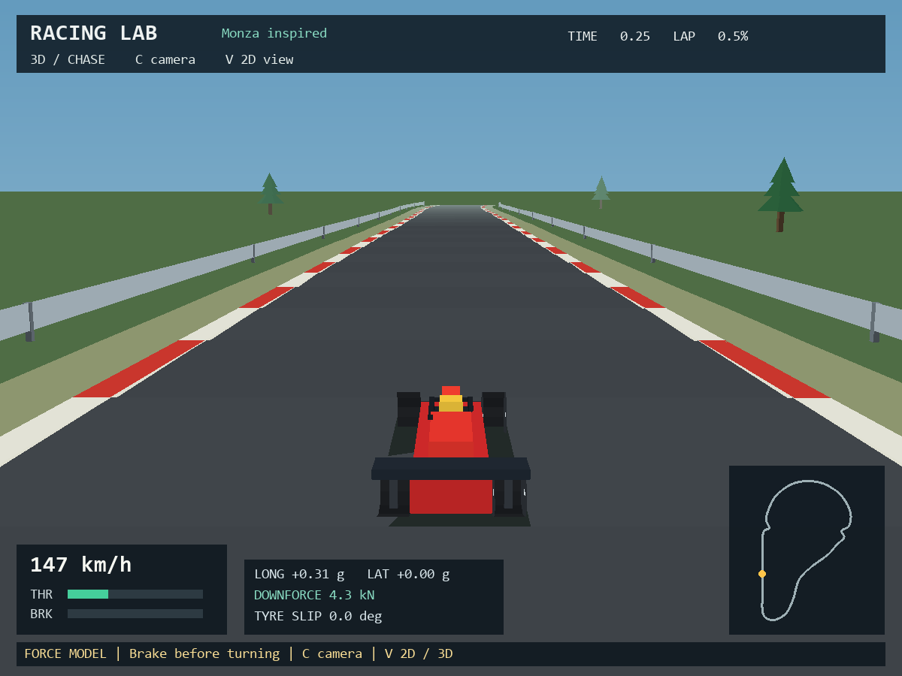

# Racing Lab

**A Python racing environment with 3D and 2D views for learning from imperfect experts.**

Drive locally, record and label your runs, train a supervised imitation baseline, and compare policies through one numerical-observation Gymnasium environment. The simulator is designed as a small, inspectable starting point for IO, IRL and RL research.



## Quick start

Requires Python 3.10+. From the project folder on Windows:

```powershell
python -m venv .venv
.\.venv\Scripts\python -m pip install -e ".[all]"
.\.venv\Scripts\python -m racing_lab.cli play --track monza
```

After installation, double-click **play.bat**. On Linux/macOS, use `.venv/bin/python` instead of `.venv\Scripts\python`.

For the commands below, activate your environment (`.\.venv\Scripts\Activate.ps1` on PowerShell, or `source .venv/bin/activate` on Linux/macOS). If PowerShell blocks activation, use the virtual environment's Python executable directly; activation is optional.

| Control | Action |
| --- | --- |
| W / up | Throttle |
| S / down | Brake |
| A, D / left, right | Steering |
| C | Cycle chase / nose / aerial cameras (following / overview in 2D) |
| V | Switch between 3D and 2D |
| R | End run for labeling |
| G / B / U | Save good / bad / unlabeled, then begin another run |
| 1–4 between runs | Monza / Silverstone / Spa / Suzuka |
| Esc | Save unlabeled and exit |

## Your first experiment

The game now starts in **3D**. Use `--view 2d` for the original presentation. Replay and rendered evaluation also support `--view 3d` and `--view 2d`. Camera changes are visual only; they never change dynamics, observations, actions, or recording formats.

Drive at least five varied runs and mark useful demonstrations **good**. Then:

```sh
python -m racing_lab.cli validate-data --data data
python -m racing_lab.cli train --data data --output models/bc.npz
python -m racing_lab.cli evaluate --model models/bc.npz --track monza --episodes 1 --render
python -m racing_lab.cli evaluate --model models/bc.npz --track all --episodes 5
```

Recordings are in `data/`, models in `models/`, and evaluation reports in `results/`. These folders are git-ignored and never automatically uploaded. To inspect a recording visually, use `python -m racing_lab.cli replay data/RECORDING.npz`.

## Import into your research

```python
from racing_lab import RacingEnv, EvaluationConfig, evaluate_policy

env = RacingEnv(track="monza")
observation, info = env.reset(seed=42)
observation, reward, terminated, truncated, info = env.step([0., .5, 0.])
env.close()

# Replace this stationary example with your own policy.
report = evaluate_policy(
    lambda observation: [0., 0., 0.],
    EvaluationConfig(tracks=("monza",), episodes=2, max_seconds=2.),
    policy_name="my-policy",
)
print(report["summary"])
```

Headless installation: `pip install -e .`. Add `[play]` for Pygame, `[train]` for scikit-learn, or `[all]` for both. Importing the research API does not initialize a game window or load either optional framework.

## Documentation

- [Physics model](docs/physics.md): tyre forces, aero, load transfer, parameters, and compatibility.
- [Research guide](docs/research-guide.md): dynamics, tracks, observations, data schema, and limitations.
- [Python API and experiments](docs/api.md): dataset arrays, reward features, snapshots, reproducible evaluation, and held-out tracks.
- [Contributing](CONTRIBUTING.md): checks and compatibility rules.
- [Changelog](CHANGELOG.md): changes to the package, simulator and recordings.
- [Runnable examples](examples/): custom policy evaluation, data loading, and branching rollouts.

## What is implemented?

Four hand-authored circuit-inspired layouts; 3D scenery and an open-wheel car; chase, nose and aerial cameras; an optional 2D view; live keyboard driving; fixed-step simulation; numerical observations; continuous controls; labeled NPZ recordings; replay; supervised behavior cloning; configurable reward features; versioned evaluation reports; and a Gymnasium interface.

The driving model now includes axle tyre slip, combined braking/cornering grip, power-limited rear-wheel drive, aerodynamic downforce and drag, and longitudinal load transfer. New force telemetry is visible and recorded. **This physics upgrade requires new demonstrations and retrained models**; older recordings remain visually replayable. See the [physics specification](docs/physics.md).

The portable 3D renderer uses perspective meshes, simple face shading, distance fog and a ground-contact car shadow. Scenery includes curbs, guardrails, trees, a pit building and a grandstand. It needs only the existing Pygame dependency, with no external assets or GPU setup. It is intentionally stylized: there are no photorealistic materials, dynamic lighting, suspension, elevation or scenery collisions. Software depth sorting can show minor overlap artifacts; press V for the lightweight research view. Performance depends on hardware, and rendering overload slows wall-clock play rather than dropping recorded simulation steps.

**This is a research prototype, not a calibrated F1 simulator or an established benchmark.** Circuits are compact approximations, Suzuka has no bridge, and dynamics use generic force-based open-wheel parameters. IO/IRL solvers and RL training algorithms are not bundled. The geometric reference controller is privileged and is not a learned baseline. Successful tests do not demonstrate that imitation improves on a human expert.

MIT licensed. Not affiliated with Formula 1 or the named circuits.
